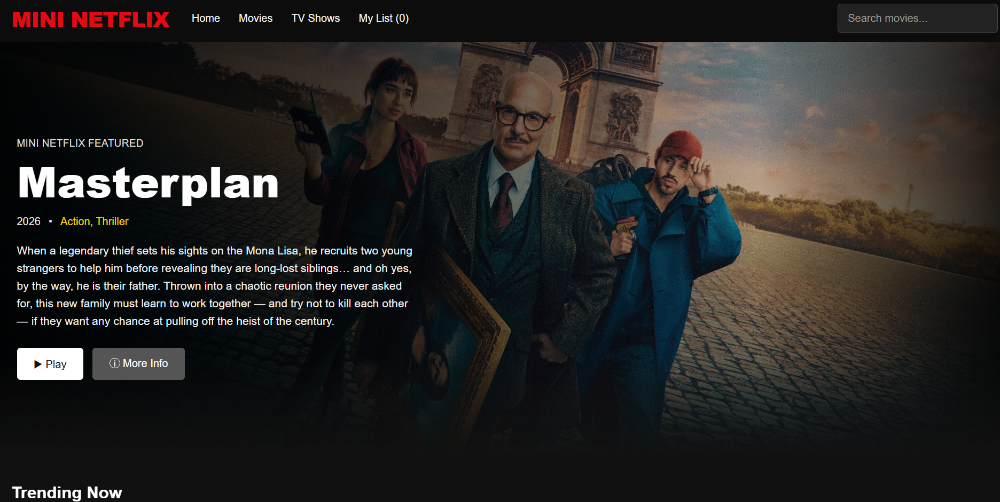
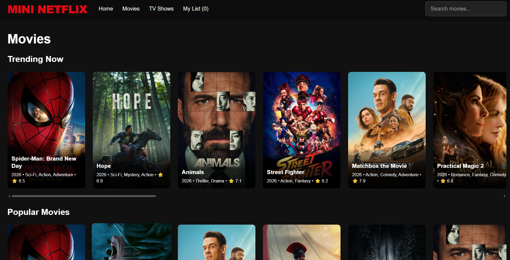
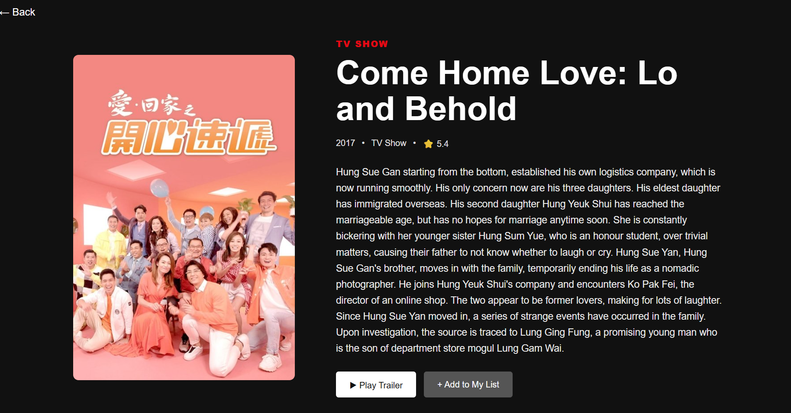

# Mini Netflix 🎬

A responsive Netflix-inspired movie discovery app built with React and Vite. Browse trending and popular titles, explore movie categories and TV shows, search for titles, view details, watch available trailers, and save favorites to My List.

## 🔴 Live Demo

**[Watch Mini Netflix](https://mini-netflix-omega.vercel.app/)**

## Features

- Netflix-inspired dark interface
- Featured hero section
- Trending and popular movies
- Action and Sci-Fi categories
- TV shows browsing
- Search for titles
- Movie/show details
- Trailer viewing when available
- My List saved in browser `localStorage`
- Responsive desktop and mobile layout

## Tech Stack

- React
- Vite
- JavaScript
- HTML5 and CSS3
- React Router
- TMDB API
- Browser `localStorage`

## Run Locally

### Prerequisites
Install Node.js and npm.

### 1. Clone the repository

```bash
git clone https://github.com/barath1307/mini-netflix.git
cd mini-netflix/Frontend
```

### 2. Install dependencies

```bash
npm install
```

### 3. Configure the TMDB API key

Create a `.env` file in the `Frontend` directory:

```env
VITE_TMDB_API_KEY=your_tmdb_api_key
```

Get an API key from your TMDB account. Do not commit your real `.env` file to GitHub.

### 4. Start the development server

```bash
npm run dev
```

Open the local URL printed by Vite, usually `http://localhost:5173`.

## Build

```bash
npm run build
npm run preview
```

## Deploy on Vercel

This repository's live demo is deployed on Vercel: https://mini-netflix-omega.vercel.app/

If redeploying this project, confirm the Vercel Root Directory matches the location of the frontend `package.json`. For a frontend inside `Frontend`, use:

- **Root Directory:** `Frontend`
- **Build Command:** `npm run build`
- **Output Directory:** `dist`
- **Environment Variable:** `VITE_TMDB_API_KEY`

Set environment variables in Vercel Project Settings and redeploy after changes.

## Environment Variable Security

Vite exposes variables prefixed with `VITE_` to browser-side code. Do not put passwords, private tokens, or server-only secrets in these variables. Keep your `.env` file out of Git.

## 📸 Screenshots

### 🏠 Home Page


### 🎬 Movies


### 📺 TV Shows


### 🎞️ Movie Details


### ❤️ My List


Movie and TV metadata and images are provided by [The Movie Database (TMDB)](https://www.themoviedb.org/).

This is a learning project inspired by the browsing experience of Netflix. It is not affiliated with or endorsed by Netflix.
